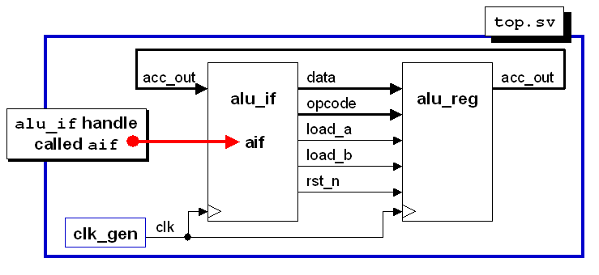

# ALU Register Verification: Class-Based SystemVerilog Testbench

A self-checking, coverage-driven testbench for a 16-bit registered ALU (`alu_reg`). It is written in plain class-based SystemVerilog, using the same agent / driver / monitor / scoreboard structure that UVM formalizes. This is Week 0 of a UVM study plan.

| Result (QuestaSim 2021.1, 1,000 constrained-random transactions) | |
|---|---|
| Verdict | **TEST PASSED**: 1,000 / 1,000 transactions checked, 0 mismatches |
| Functional coverage | **100 %** transaction coverage, **100 %** control coverage |
| Checker validation | Injected DUT bug detected on every affected transaction, no false alarms |

## Design Under Test

`alu_reg` loads operand B into a register (`load_b`), applies one of four operations to the `data` input and B, and captures the result in an output register (`load_a`). It has a synchronous active-low reset and one cycle of latency.

| `opcode` | Result |
|---|---|
| `PASSA` | `data` |
| `NAND` | `~(data & b)` |
| `OR` | `data \| b` |
| `ADD` | `data + b` (16-bit, wraps on overflow) |



Full details are in the [design specification](docs/Spec.md).

## Testbench Architecture

```
tb_top
 ├── hw_top ── alu_reg (DUT) · alu_if (clocking blocks, coverage, assertions) · clkgen
 └── alu_vc
      ├── agent: sequencer → driver ──► alu_if ──► monitor
      ├── scoreboard    ◄── mailbox ── monitor   (reference model, PASS/FAIL)
      └── alu_coverage  ◄── mailbox ── monitor   (functional coverage)
```

- **Stimulus:** constrained-random packets with weighted opcodes, operand corner values (`0000`, `FFFF`, `AAAA`, `5555`) and both loads on the same edge.
- **Monitor:** rebuilds each transaction from the pins, following the spec's cycle model, and sends it to every subscriber.
- **Scoreboard:** predicts `acc_out`, flags each mismatch, checks that every driven transaction was checked, and prints a single verdict.
- **Assertions:** `acc_out` holds while `load_a = 0`, and clears on reset.
- **Coverage:** a transaction covergroup (opcodes, operand corners, crosses, ADD overflow), a cycle-level control covergroup (load combinations, back-to-back loads, reset) and a cover property.

## Repository Structure

```
.
├── docs/
│   ├── Spec.md                        Design specification
│   ├── alu_reg_verification_plan.md   Verification plan
│   ├── alu_vc_issue_log.md            Issue log and simulation results
│   └── media/                         Block diagrams
├── sv/                                Verification component (alu_pkg)
│   ├── alu_pkg.sv  alu_if.sv  alu_pkt.sv  cycle.sv
│   ├── sequencer.sv  driver.sv  monitor.sv  agent.sv
│   ├── scoreboard.sv  coverage.sv  alu_vc.sv  component_base.sv
│   └── vc_test.sv                     Standalone VC test (no DUT)
└── tb/                                DUT and integrated testbench
    ├── alu_reg.sv  clk_gen.sv  hw_top.sv  tb_top.sv
    └── run.f  run.do                  Compile list and run script
```

## Running

**Requirements:** QuestaSim / ModelSim with SystemVerilog support (tested with QuestaSim-64 2021.1).

```bash
cd tb
vsim -c -do run.do        # batch: compile, simulate, save coverage, exit
vsim -do run.do           # GUI: same, then stays open for waves and debug
```

| Option | How |
|---|---|
| Number of transactions | `+NUM_PKTS=<n>` on the `vsim` line in `run.do` (default 1000) |
| Reproduce a run | `-sv_seed <N>`, using the seed printed as `Sv_Seed = N` |
| Coverage per bin | `vcover report -details alu_cov.ucdb` |

A passing run ends with:

```
Scoreboard report: 1000 checked, 0 mismatches
Assertion failures: 0
TEST PASSED
```

## Documentation

| Document | Content |
|---|---|
| [Design specification](docs/Spec.md) | Ports, function, reset, timing, operating sequence |
| [Verification plan](docs/alu_reg_verification_plan.md) | Scope, environment, stimulus, checking, coverage model, completion criteria, results |
| [Issue log](docs/alu_vc_issue_log.md) | Issues found and resolved, simulation results, history |

## Known Limitations

- The internal `b` register's hold and reset behavior is checked only indirectly, through results.
- Reset is applied only at the start of simulation. Reset with a load, and reset during operation, are out of scope.
- The `acc_out` assertions were added after the final regression and have not yet been run in simulation.

See the [verification plan](docs/alu_reg_verification_plan.md#11-known-limitations) for details.
