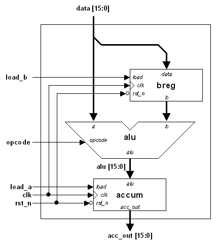
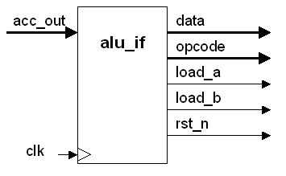
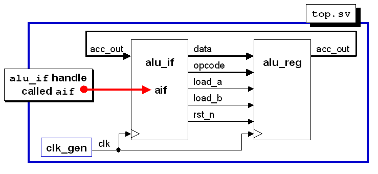

# alu_reg Design Specification

| Item | Value |
|---|---|
| Module name | `alu_reg` |
| Package dependency | `alu_pkg` (provides `op_e`) |
| Data width | 16 bits |
| Clocking | Single clock, rising edge (`clk`) |
| Reset | Synchronous, active-low (`rst_n`) |
| Language | SystemVerilog |

---

## 1. Overview

`alu_reg` is a small registered ALU datapath. It combines:

- an **operand register** (`breg`) that stores operand B,
- a **combinational ALU** that computes a result from the live `data` input (operand A) and the stored B value,
- a **result register** (`accum`) that captures the ALU result and drives `acc_out`.

Despite the name `accum`, the result register is **not fed back** into the ALU. Operand A always comes from the `data` input, so the block behaves as "ALU followed by an output register", not as a true accumulator (see [Section 9](#9-known-limitations-and-recommendations)).

## 2. Block Diagrams

### 2.1 `alu_reg` Internal Architecture



*Figure 1: `alu_reg` internals. `data` feeds both the `breg` operand register and ALU input `a`. `breg` supplies operand `b`. The ALU result is captured by `accum`, which drives `acc_out`. `clk` and `rst_n` are shared by both registers.*

### 2.2 `alu_if` Interface



*Figure 2: `alu_if` interface. It drives the stimulus signals (`data`, `opcode`, `load_a`, `load_b`, `rst_n`) and observes `acc_out` from the DUT. It is clocked by `clk`.*

### 2.3 Top-Level Integration (`hw_top.sv`)



*Figure 3: `hw_top.sv`. `clk_gen` supplies `clk` to both `alu_if` and `alu_reg`. The `alu_if` signals connect to the matching `alu_reg` ports, and `acc_out` from `alu_reg` is fed back to `alu_if`. The `alu_if` instance is accessed through a handle named `aif`.*

## 3. Interface

### 3.1 Ports

| Port | Direction | Width | Description |
|---|---|---|---|
| `clk` | input | 1 | Clock. All registers update on the rising edge. |
| `rst_n` | input | 1 | Synchronous reset, active-low. Clears both registers. |
| `data` | input | 16 | Data input. Loaded into `breg` and used as ALU operand A. |
| `opcode` | input | `op_e` | Selects the ALU operation. |
| `load_b` | input | 1 | Load enable for `breg`. |
| `load_a` | input | 1 | Load enable for `accum`. |
| `acc_out` | output | 16 | Output of the result register. |

### 3.2 Internal Signals

| Signal | Width | Description |
|---|---|---|
| `b` | 16 | Output of `breg`; ALU operand B. |
| `alu` | 16 | Combinational ALU result; input to `accum`. |

### 3.3 Interface Signals (`alu_if`)

`alu_if` groups the signals that connect to `alu_reg` (see Figure 2 and Figure 3).

| Signal | Direction (from `alu_if`) | Width | Connects to `alu_reg` port |
|---|---|---|---|
| `clk` | input | 1 | `clk` (also driven by `clk_gen`) |
| `acc_out` | input | 16 | `acc_out` |
| `data` | output | 16 | `data` |
| `opcode` | output | `op_e` | `opcode` |
| `load_a` | output | 1 | `load_a` |
| `load_b` | output | 1 | `load_b` |
| `rst_n` | output | 1 | `rst_n` |

Testbench code accesses these signals through the handle `aif`.

## 4. Functional Description

### 4.1 `breg` (Operand B Register)

- Triggered on `posedge clk`.
- If `rst_n == 0`: `b <= 16'h0000`.
- Else if `load_b == 1`: `b <= data`.
- Otherwise `b` holds its value.

### 4.2 `alu` (Combinational ALU)

Operand A is the current value on `data`. Operand B is the stored value `b`. The output `alu` responds immediately (no clock) to changes on `data`, `b`, or `opcode`.

| `opcode` | Operation | Result |
|---|---|---|
| `PASSA` | Pass A | `data` |
| `NAND` | Bitwise NAND | `~(data & b)` |
| `OR` | Bitwise OR | `data \| b` |
| `ADD` | Unsigned add | `data + b` (16-bit, carry-out discarded, wraps on overflow) |

The numeric encoding of each opcode is defined by `op_e` in `alu_pkg`.

### 4.3 `accum` (Result Register)

- Triggered on `posedge clk`.
- If `rst_n == 0`: `acc_out <= 16'h0000`.
- Else if `load_a == 1`: `acc_out <= alu`.
- Otherwise `acc_out` holds its value.

## 5. Reset Behavior

- Reset is **synchronous**: `rst_n` is sampled only on the rising edge of `clk`.
- Reset has **priority** over `load_a` and `load_b`.
- While `rst_n` is low at a clock edge, both `b` and `acc_out` are cleared to `0`.
- Register contents are undefined before the first clock edge with `rst_n` asserted.

## 6. Timing

| Path | Description |
|---|---|
| `data` → `b` | Captured at the next `posedge clk` when `load_b = 1`. |
| `data`, `b`, `opcode` → `alu` | Purely combinational. |
| `alu` → `acc_out` | Captured at the next `posedge clk` when `load_a = 1`. |
| `acc_out` | Registered output; changes only after a clock edge. |

- Latency from `data` to `acc_out` is **one clock cycle** (combinational ALU, then register).
- The critical path is `data` / `b` / `opcode` through the ALU (the 16-bit adder dominates) into `accum`.
- `data`, `opcode`, `load_a`, and `load_b` must meet setup and hold times relative to `clk`.

## 7. Operating Sequence

Typical use:

1. Drive `rst_n = 0` for at least one clock edge, then release it.
2. Drive operand on `data`, assert `load_b` for one clock edge. `b` now holds the operand.
3. Drive the new operand on `data`, set `opcode`, assert `load_a` for one clock edge.
4. After that edge, `acc_out` holds the result of the selected operation.

Example (`ADD`): load `b = 5`, then present `data = 3`, `opcode = ADD`, pulse `load_a`. Result: `acc_out = 8`.

## 8. Verification

Verification of `alu_reg` is defined in a separate document, [`alu_reg_verification_plan.md`](alu_reg_verification_plan.md). It covers the features and corner cases to verify, the testbench, stimulus, reference model, coverage model, completion criteria and results.

---

## 9. Known Limitations and Recommendations

1. **Not a true accumulator.** `acc_out` is never fed back into the ALU. To implement `acc = acc OP b`, route `acc_out` into operand A (typically with a mux selecting `data` vs `acc_out`).
2. **Incomplete `case`.** The ALU `case` has no `default`. If `op_e` has values beyond the four listed, or `opcode` is X, `alu` may infer a latch or produce X. Recommended fix:
   ```systemverilog
   default: alu = '0;
   ```
3. **`always_comb` and X-propagation.** Without a default, behavior on illegal opcodes is simulator and synthesis dependent.
4. **No flags.** There is no carry, zero, or overflow output.
5. **Unsigned arithmetic only.** `ADD` is treated as an unsigned 16-bit add with silent wraparound.

## 10. Revision History

| Version | Date | Description |
|---|---|---|
| 0.1 | 2026-11-19 | Initial specification derived from RTL and block diagram. |
| 0.2 | 2026-11-19 | Added `alu_reg`, `alu_if`, and top-level diagrams from `media/`; added `alu_if` signal table. |
| 0.3 | 2026-11-23 | Verification plan narrowed: removed F2 (reset priority) and the *reset asserted mid-operation* corner case; `opcode` × `load_a` × `load_b` cross limited to cycles that carry a load. Feature IDs unchanged. Design behavior (Sections 4–5) unchanged. |
| 0.4 | 2026-11-23 | Verification plan (Section 8) moved to `alu_reg_verification_plan.md`; Section 8 now points to it. |
